  

    

  
  
  
  

 

Hello there! I'm <b><i>Emerson Henrique</i></b>, a Computer Science student at the Federal University of Campina Grande (UFCG) and a Full-Stack Developer.
I currently work in Research &amp; Development at <b>UFCG</b>, building autonomous agents and LLM-powered systems while exploring software architecture across object-oriented and functional paradigms.

&nbsp; <i><b>Studying Computer Science at UFCG</b></i> 
&nbsp; <i><b>R&amp;D at UFCG (Autonomous Agents &amp; LLMs)</b></i> 
&nbsp; <i><b>Full-Stack Development &amp; Functional Programming</b></i>

 

  
  
  
  
  
  
  
   
  
  
  
  
  
  
   
  
  
  
  
  
  

 

  
  
   
  
   
  

